[README.md](https://github.com/user-attachments/files/35360545/README.md)[README.md](https://github.com/user-attachments/files/35360639/README.md)<p align="center">
  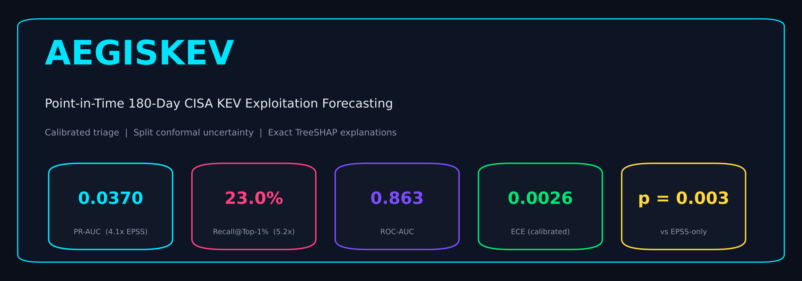
</p>

<p align="center">
  
</p>

<p align="center">
  <a href="https://github.com/vishweshwaranbalasundaram/AegisKEV/actions/workflows/ci.yml"></a>
</p>

<p align="center">
  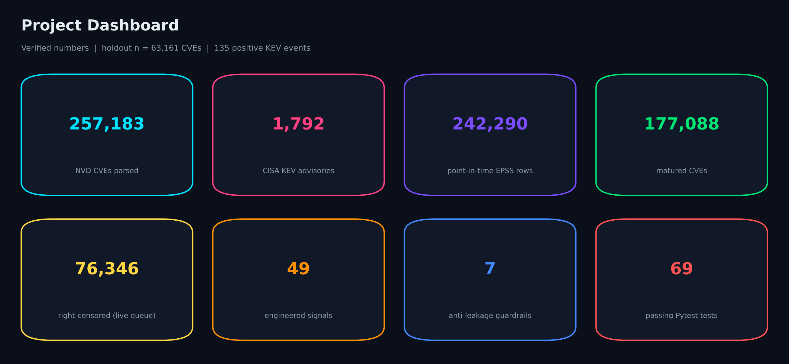
</p>

<div align="center">

### Point-in-Time 180-Day CISA KEV Exploitation Forecasting and Calibrated Triage Workbench

*Freeze the clock at disclosure. Predict exploitation. Quantify uncertainty. Explain every score.*

[Results](#results) | [Guardrails](#seven-anti-leakage-guardrails) | [Architecture](#system-architecture) | [Screenshots](#analyst-workbench-screenshots) | [Quick Start](#quick-start)

</div>

---

## Table of Contents

1. [Problem Statement](#problem-statement)
2. [Solution](#solution)
3. [Data Corpus and Chronological Splits](#data-corpus-and-chronological-splits)
4. [Seven Anti-Leakage Guardrails](#seven-anti-leakage-guardrails)
5. [Feature Engineering](#feature-engineering)
6. [Modeling, Calibration, Conformal UQ and Explainability](#modeling-calibration-conformal-uq-and-explainability)
7. [Results](#results)
8. [System Architecture](#system-architecture)
9. [Analyst Workbench Screenshots](#analyst-workbench-screenshots)
10. [API Surface](#api-surface)
11. [Quick Start](#quick-start)
12. [Repository Layout](#repository-layout)
13. [Author](#author)

---

## Problem Statement

Security teams receive more than 40,000 new CVEs every year, yet fewer than 0.3% are weaponized in the wild within 180 days. Existing signals each fail in a different way:

| Signal | Failure Mode |
|:---|:---|
| **CVSS** | Over-alerts on theoretical severity. On the holdout it scores 0.0043 PR-AUC and 0.240 ECE. |
| **CISA KEV** | Authoritative ground truth, but reactive: a CVE is added only after active exploitation. |
| **FIRST EPSS** | Models a 30-day window, shifts across model versions (notably EPSS v3 to v4 in March 2025), and offers no per-CVE feature attribution. |

## Solution

AegisKEV freezes the observation clock at:

```
t_anchor = published_date + 1 day   (UTC midnight)
```

and predicts whether a newly disclosed CVE will be added to CISA KEV within 180 days. Every score is paired with:

- a **calibrated probability** (Platt sigmoid on a held-out calibration window),
- a **split conformal uncertainty set** (`{0}`, `{1}`, or `{0, 1}`) that routes ambiguous cases to a human analyst,
- **exact TreeSHAP** global and per-CVE local explanations.

---

## Data Corpus and Chronological Splits

| Source | Volume | Notes |
|:---|---:|:---|
| NIST NVD 2.0 JSON feeds (2021-2026) | 257,183 non-rejected CVEs | Nested-gzip safe decoding |
| CISA KEV Catalog | 1,792 advisories | Ground-truth label source |
| FIRST EPSS Historical Daily Archives | 242,290 anchored rows | Joined on `t_anchor` |

**Maturation and right-censoring (snapshot cutoff 2026-05-27):** 177,088 CVEs have a fully observed 180-day horizon and are used for training and evaluation. 76,346 CVEs disclosed after the cutoff are right-censored, excluded from training and evaluation to prevent false-negative label corruption, and served in the Live Triage Queue.

<p align="center">
  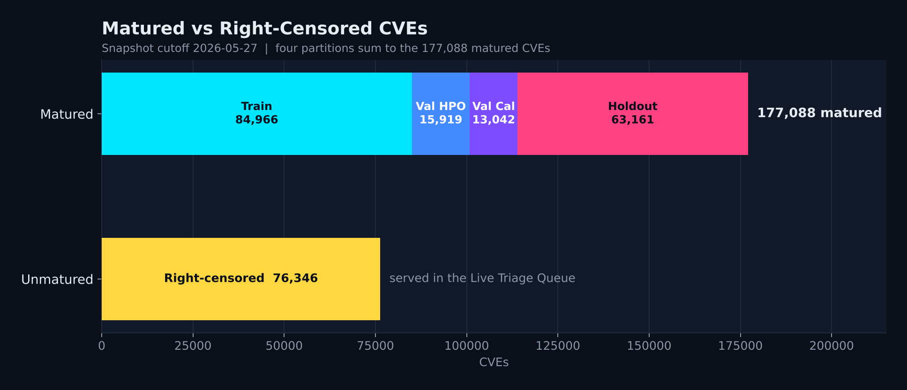
</p>

The partitions deliberately straddle the March 2025 EPSS v4 regime shift to test generalization.

| Partition | Date Range | Rows | Positive Rate | Purpose |
|:---|:---|---:|---:|:---|
| Train | 2021-01-01 to 2024-06-30 | 84,966 | 0.301% | Model fitting |
| Val HPO | 2024-07-01 to 2024-11-15 | 15,919 | 0.239% | Optuna hyperparameter tuning |
| Val Calibration | 2024-11-16 to 2025-03-16 | 13,042 | 0.284% | Platt calibration and conformal quantile |
| Holdout Test | 2025-03-17 to 2026-05-27 | 63,161 | 0.214% | Untouched final evaluation (135 positive KEV events) |

<p align="center">
  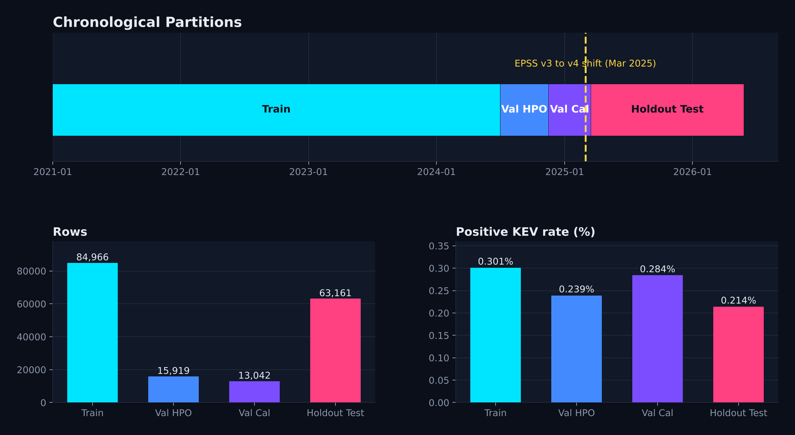
</p>

---

## Seven Anti-Leakage Guardrails

All seven guardrails are verified by **69 Pytest tests**.

| # | Guardrail | What It Enforces |
|:-:|:---|:---|
| 1 | **Future Field Stripping** | Drops NVD `cisaExploitAdd`, `cisaActionDue`, `cisaRequiredAction`, and `cisaVulnerabilityName`, which are appended post-exploitation. |
| 2 | **Exact Anchor Clock** | Sets `t_anchor = published_date + 1 day`. |
| 3 | **Temporal Eligibility** | Excludes CVEs already in CISA KEV on or before `t_anchor`. |
| 4 | **180-Day Right-Censoring** | Excludes CVEs with incomplete 180-day windows from training and evaluation. |
| 5 | **Point-in-Time EPSS Lookup** | Joins strictly against the historical FIRST EPSS daily CSV published on `t_anchor`. |
| 6 | **Delayed Causal Group Priors** | Smoothed Bayesian m-estimate exploitation rates for `cwe_primary` and `primary_vendor`, using a strict 180-day maturation queue (outcomes revealed only after `published_date + 180d <= current t_anchor`). |
| 7 | **Scale-Invariant Cohort Normalization** | Computes `epss_same_day_pct` (within-day percentile rank) and `epss_minus_cvss_norm` so features remain stable across the March 2025 EPSS v4 probability rescaling. |

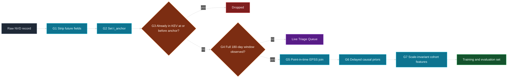

---

## Feature Engineering

49 signals are built across three cumulative stages.

| Stage | Feature Count | Contents |
|:---|:-:|:---|
| **Stage 1: Base NVD + EPSS** | 19 | CVSS base, exploitability and impact scores; attack vector, complexity, privileges, user interaction and scope flags; CWE count; CPE config and vendor counts; reference count; vendor advisory, patch and exploit tag flags; anchored EPSS, EPSS percentile, EPSS logit, missing flag. |
| **Stage 2: Causal Priors and Exploit-vs-Patch Race** | 25 | Adds `cwe_kev_prior`, `primary_vendor_kev_prior`, `epss_same_day_pct`, `epss_minus_cvss_norm`, `exploit_without_patch_race`, `zero_click_network_flaw`, `exploit_to_impact_ratio`. |
| **Stage 3: Text Semantics** | 49 | Adds 24-component TF-IDF plus TruncatedSVD embeddings over English CVE descriptions. |

---

## Modeling, Calibration, Conformal UQ and Explainability

**Models evaluated:** LightGBM (Optuna-tuned, 25 trials, val_hpo PR-AUC 0.0841), XGBoost (0.0846), CatBoost (0.0984, val_hpo champion), Stacked Ensemble (3-fold expanding window), Logistic Regression, Random Forest, and two rule baselines (`Rule_EPSS_Only`, `Rule_CVSS_Only`).

**Calibration:** post-hoc Platt sigmoid through `FrozenEstimator`, fitted on `val_cal`.

**Split conformal UQ:** alpha = 0.10, `q_hat = 0.00389`. Output is a prediction set of `{0}`, `{1}`, or `{0, 1}`; ambiguous cases are flagged for human review. Empirical coverage across the EPSS v4 regime shift is 81.7%, empty sets are 18.2%, average set size is 0.818.

**Explainability:** exact `shap.TreeExplainer` for global importances and local per-CVE waterfalls.

---

## Results

All figures are computed on **n = 63,161 untouched test CVEs** (135 positive KEV events).

### Model benchmark

<p align="center">
  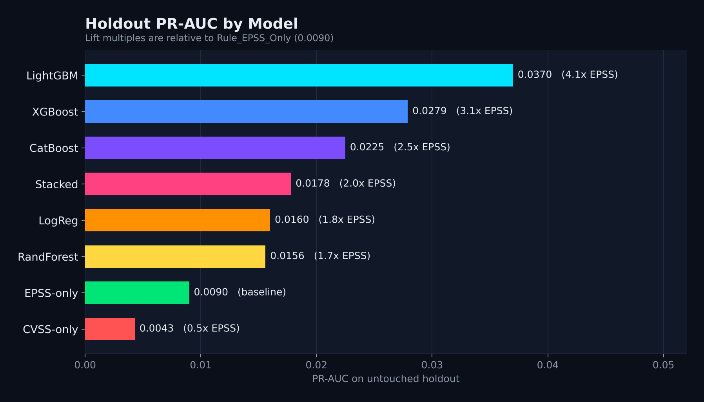
  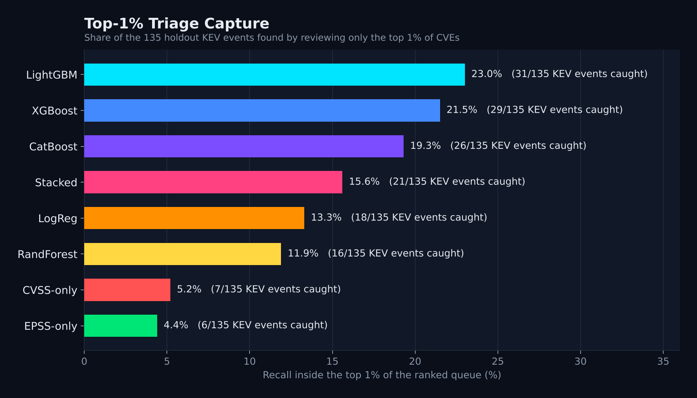
</p>

<p align="center">
  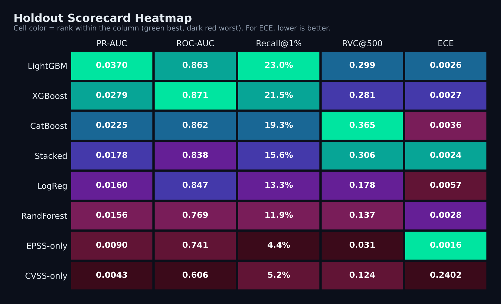
  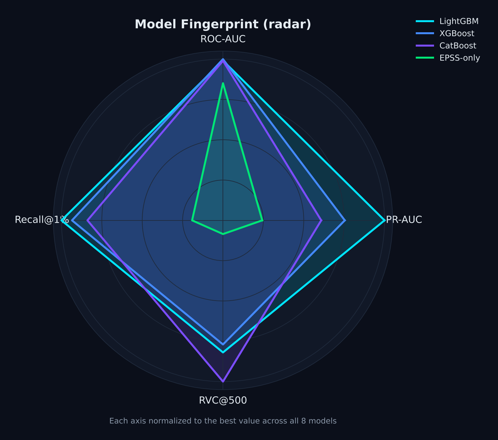
</p>

| Model | PR-AUC | ROC-AUC | Recall@Top-1% | Precision@1% | RVC@500 | ECE | p-value vs EPSS |
|:---|---:|---:|:---|---:|---:|---:|---:|
| **LightGBM (Optuna Tuned)** | **0.0370** | 0.863 | **23.0%** (31/135) | 4.91% | 0.299 | 0.0026 | 0.003 |
| XGBoost (Optuna Tuned) | 0.0279 | 0.871 | 21.5% (29/135) | 4.59% | 0.281 | 0.0027 | 0.009 |
| CatBoost (Val-HPO Champion) | 0.0225 | 0.862 | 19.3% (26/135) | 4.11% | 0.365 | 0.0036 | 0.024 |
| Stacked Ensemble | 0.0178 | 0.838 | 15.6% (21/135) | n/a | 0.306 | 0.0024 | 0.058 |
| Logistic Regression | 0.0160 | 0.847 | 13.3% (18/135) | n/a | 0.178 | 0.0057 | 0.067 |
| Random Forest | 0.0156 | 0.769 | 11.9% (16/135) | n/a | 0.137 | 0.0028 | 0.086 |
| Rule_EPSS_Only | 0.0090 | 0.741 | 4.4% (6/135) | 0.95% | 0.031 | 0.0016 | baseline |
| Rule_CVSS_Only | 0.0043 | 0.606 | 5.2% (7/135) | 1.11% | 0.124 | 0.2402 | n/a |

LightGBM headline: PR-AUC is 4.1x the EPSS-only rule, Recall@Top-1% is 5.2x, RVC@500 is 9.6x. F1@1% is 0.0808 and Brier is 0.0022.

### Statistical significance and calibration

<p align="center">
  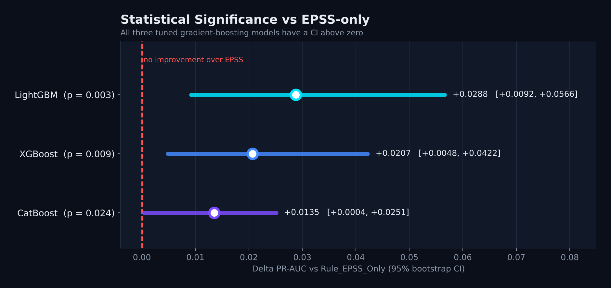
  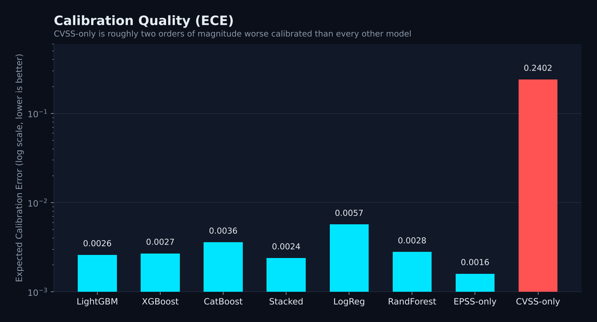
</p>

| Model | Delta PR-AUC vs EPSS | 95% Bootstrap CI | p |
|:---|---:|:---|---:|
| LightGBM | +0.0288 | [+0.0092, +0.0566] | 0.003 |
| XGBoost | +0.0207 | [+0.0048, +0.0422] | 0.009 |
| CatBoost | +0.0135 | [+0.0004, +0.0251] | 0.024 |

`Rule_CVSS_Only` has a Brier score of 0.1827 and an ECE of 0.2402: the over-alerting failure mode described in the problem statement.

### Why it works: three-stage ablation

<p align="center">
  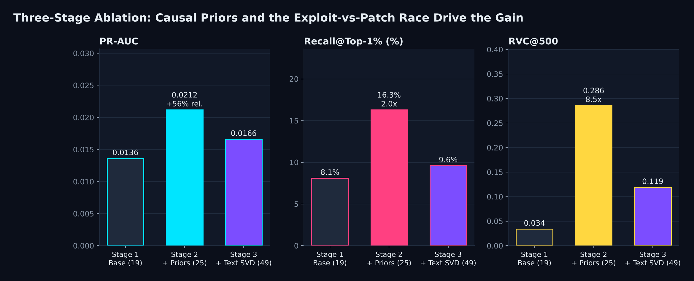
</p>

| Stage | Features | PR-AUC | ROC-AUC | Recall@1% | RVC@500 | ECE |
|:---|:-:|---:|---:|---:|---:|---:|
| Stage 1: Base NVD + EPSS | 19 | 0.0136 | 0.825 | 8.1% | 0.034 | 0.0028 |
| Stage 2: + Causal Priors and Race | 25 | **0.0212** (+56% relative) | 0.825 | **16.3%** (2.0x) | **0.286** (8.5x) | 0.0021 |
| Stage 3: + Text SVD Embeddings | 49 | 0.0166 | **0.854** | 9.6% | 0.119 | 0.0030 |

<p align="center">
  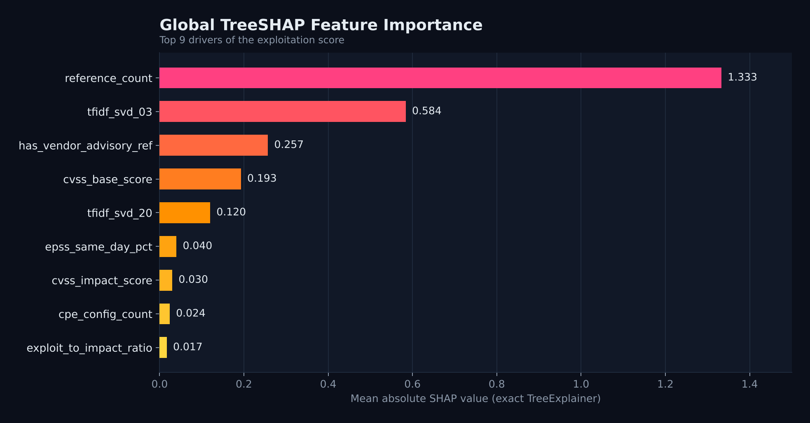
</p>

### Uncertainty

<p align="center">
  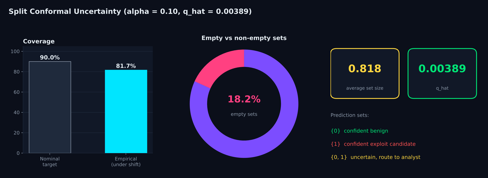
</p>

<sub>Charts are regenerated with <code>python scripts/generate_charts.py</code> (output: <code>docs/charts/</code>).</sub>

---

## System Architecture

### End-to-end pipeline

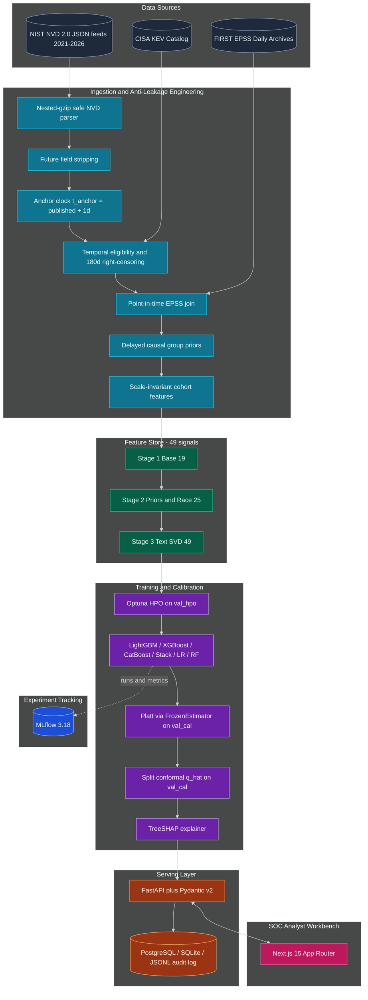

### Runtime inference and conformal UQ

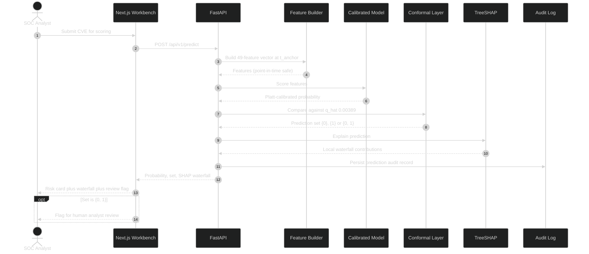

### Container topology

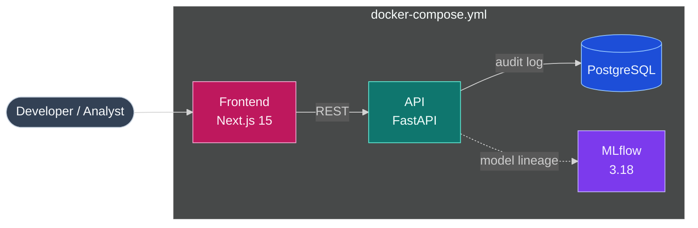

---

## Analyst Workbench Screenshots

Next.js 15 SOC Analyst Workbench with a dark cyber-intelligence UI.

| View | Description |
|:---|:---|
| **Risk Scorer** | Calibrated probability, conformal prediction set, and local TreeSHAP waterfall for a single CVE. |
| **Benchmark and Ablation** | Holdout benchmark comparison and the three-stage ablation charts. |
| **Live Triage Queue** | Right-censored (unmatured) CVEs ranked for analyst review. |

<!-- Uncomment once the PNGs are added under docs/screenshots/


-->

---

## API Surface

Backend: FastAPI (`backend/app/main.py`) with Pydantic v2 schemas (`schemas.py`) and PostgreSQL / SQLite / JSONL prediction audit logging.

| Method | Endpoint | Purpose |
|:---|:---|:---|
| GET | `/health` | Service health check |
| POST | `/api/v1/predict` | Calibrated score, conformal set, and TreeSHAP explanation for a CVE |
| GET | `/api/v1/metrics/benchmark` | Verified holdout benchmark and ablation metrics |
| GET | `/api/v1/triage/recent` | Live Triage Queue over unmatured CVEs |
| GET | `/api/v1/reports/markdown` | Downloadable analyst report |

---

## Quick Start

```bash
git clone https://github.com/vishweshwaranbalasundaram/AegisKEV.git
cd AegisKEV

# Full stack: API, Frontend, PostgreSQL, MLflow
docker compose up --build
```

Run the anti-leakage test suite locally:

```bash
pytest
```

Service ports and environment variables are defined in `docker-compose.yml`.

---

## Repository Layout

```
AegisKEV/
|-- backend/
|   `-- app/
|       |-- main.py            FastAPI application
|       `-- schemas.py         Pydantic v2 schemas
|-- frontend/                  Next.js 15 App Router SOC Analyst Workbench
|-- docs/
|   |-- charts/                Generated PNG charts used in the README
|   `-- screenshots/           Workbench screenshots (add later)
|-- scripts/
|   `-- generate_charts.py     Regenerates docs/charts/*.png
|-- .github/
|   `-- workflows/ci.yml       GitHub Actions CI
|-- Dockerfile                 Multi-stage build
|-- docker-compose.yml         API, Frontend, PostgreSQL, MLflow
`-- README.md
```

---

## Author

**Vishweshwaran** - Computer Science and Engineering, Rajalakshmi Engineering College, Chennai.

GitHub: [vishweshwaranbalasundaram](https://github.com/vishweshwaranbalasundaram)
